# EDA report: SIM interventions, 2020 to 2026-09-24

Team 4, YCIT 440 capstone, Project B (fire-service operations).
Source notebook: [`notebooks/01_eda.ipynb`](../notebooks/01_eda.ipynb). Every EDA number here comes
from [`eda_numbers.json`](eda_numbers.json), which the notebook writes.

**This is the current EDA report, written for readers with or without a data science
background.** It starts with a plain summary (§0), explains technical terms where they first
appear, says how to read each table, and ends with a glossary (§8). Since the presentation it
replaces the 2024-only baseline preview with the 2021–2024 rolling-origin results
([`baseline_report.md`](baseline_report.md)), notes where the later modelling confirmed or changed
an EDA implication ([`final_report.md`](final_report.md)), and qualifies the Step 2 completeness
checks. The report as presented on 2026-10-15 is kept in git at tag
[`v1.6.0`](https://github.com/abouganemi/ycit440-sim-forecast/blob/v1.6.0/reports/eda_report.md).

**Framing (team-accepted v2).** Forecast, one calendar day ahead, the number of SIM interventions
**published in the open data** for each operational Division 1–6. The forecast for day *D* is
prepared on *D−1* using completed daily counts through *D−3*. The baseline (a simple rule that any
model must beat) is the mean of recent same-weekday values, with the window (how many past weeks
are averaged) chosen on validation data (the 2021–2024 years used to choose and compare
methods). The primary metric is MAE (mean absolute error: the average size of the miss, in
interventions per day, where lower is better) reported with bias (the average of forecast minus
actual: negative means the forecast is too low on average, positive too high). The forecast
measures volume, not workload.

**Method.** The notebook follows the ten steps of the course *Dataset Investigation Guide*, then
standard EDA. It recomputes every number stated in the v2 documents (`DEFINITIVE` report, v2
Dataset Investigation Guide, `verification/09_FINAL_VERIFIED.md`) from the local files and stops if
one does not reproduce. **All of them reproduce.** Structure that could influence modelling
(seasonality, autocorrelation, dispersion, baseline windows) is estimated on **2021–2024 only**.
The proposed test period, 2025 onward, is only inspected for level changes.

**How to read this report.** Section 0 is a plain-language summary and can be read on its own.
Section 1 lists the ten key findings. Section 2 is the dataset description drafted for the
executive report, and sections 3 and 4 are reference tables for the dataset and its variables.
Section 5 holds the detailed evidence, step by step, and each table there has a sentence on how to
read it. Section 6 draws the implications for modelling and checks them against the later results,
and section 7 lists what is new compared with the v2 documents. A glossary of terms is in section
8. Technical terms are explained where they first appear, and the technical name is kept next to
the plain explanation. In this report a division-day is one division on one day, and the "level"
is the typical daily count.

---

## 0. Summary in plain language

**What the data are.** Each row is one fire-service intervention (an incident that the Montréal
fire service, SIM, responded to) published on the city's open-data portal: 754,413 records from
2020-01-01 to 2026-09-24. We count the rows per day for each of the six operational divisions of
SIM. The published file holds about 94% of the yearly totals SIM reports, and the reason for the
gap is not documented, so we call our target "published interventions", not "all
interventions".

**What is forecast, and why the D−3 cutoff.** The forecast is the number of published
interventions in each division on a given day, made one day ahead. The forecast for day *D* is
prepared on day *D−1*, but it may only use counts up to day *D−3*, because the portal publishes
about 2 days late. Without this cutoff, tests would look better than the forecast could ever be in
real use.

**The findings that matter most.**

1. **The level is not stable.** The mean volume rose from 227 interventions a day in 2020 (the
   COVID year, when first-responder records almost vanished) to 358 a day in 2025. From late 2025,
   first-responder calls fell 25–30% in Divisions 1–5 (the cause is not documented). We therefore
   train on 2021–2024 and test on 2025 onward, which includes the drop.
2. **Calendar patterns are weak.** Day of week moves a division's count by no more than ±9%
   around its mean, and the repeating weekly pattern is weak compared with the slow changes in level. A forecast cannot lean much on the
   calendar. Counts from three days earlier help only a little (their correlation with today's
   count is 0.16–0.38, on a scale where 0 means no link and 1 means they move perfectly together).
3. **Storm days dominate the errors.** About 1% of division-days (134) are unusual, and 16 dates
   hit at least three divisions at once. The worst is the April 2023 ice storm (1,712
   interventions on 2023-04-06). Neither the calendar nor earlier counts can predict these days,
   and they cause the largest misses.
4. **The two simple baselines tie.** The same-weekday mean over 13 weeks scores 8.48 and the plain
   28-day mean scores 8.49 (average miss per division-day, 2021–2024). Any model has to beat both.
5. **Division 6 differs.** Its first-responder calls rose 9.5% in 2026 while Divisions 1–5 fell. It
   has a weekend peak, its counts still partly track those of four weeks earlier (correlation 0.33, against 0.01–0.07
   elsewhere), and in 2026 it sits 44% above
   the pattern shared by the divisions.

**What the data cannot tell us.** The data hold no durations, response or arrival times, responding
units, crew size, staffing, unit availability, costs or unmet demand. The forecasts estimate
**recorded intervention volume**. They are not estimates of workload, staffing, vehicle needs or
response-time performance, and we make no claims about those. The storm dates match weather
patterns but have not been checked against weather records. Three questions are open: what
changed in first-responder dispatch in late 2025, what `DIVISION = 0` means, and whether public
weather forecasts should be added.

---

## 1. Key findings

1. **The target can be built, and it is dense.** There are 14,748 division-days (6 divisions times
   2,458 days). The median is 53 interventions per day, and no division has a zero day. **2024-12-31 is absent from both files**,
   so it is treated as missing, not as zero. The 600 `DIVISION = 0` rows are undocumented and
   excluded.
2. **The open data are a subset of SIM activity.** Published counts are 93.8%, 94.3% and 93.5% of
   the totals SIM reports for 2022, 2023 and 2024; part of the 2024 gap is the missing
   2024-12-31 (about 0.3 points). If incident numbers are issued without gaps, about 6–7% of
   each year's never appear; neither check says why. The target must be called "published
   interventions".
3. **The level is not stable.** Mean volume went from 227/day (2020, COVID) to 358/day (2025),
   and was flat in 2023–24.
   - **Spring 2020.** First-responder records (group `1-REPOND`, the calls to which the fire
     service responds as first responder) almost vanish: 56 days between 2020-04-07 and
     2020-07-07 have fewer than 5.
   - **Late 2025.** A drop starts and is concentrated in first-responder calls. For Jan 1 – Sep 24,
     2026 against the same span of 2025:
     - first-responder calls fell 25–30% in Divisions 1–5 and rose 9.5% in Division 6;
     - all other interventions were flat or up (+1% to +16%, except Division 4 at −1.2%).
   - The cause is not documented.
4. **Calendar structure is weak.** The weekday index (each weekday's average compared with the
   division's overall mean) stays within ±9% of each division's mean. STL weekly-seasonal strength
   is 0.06, against 0.33 for trend. STL splits a daily series into a slow trend, a repeating
   weekly pattern and leftover noise, and "strength" scores how much of the variation the trend or
   the weekly pattern explains, from 0 (none) to 1 (all). So the weekly pattern is close to
   absent. Division 6 (Ville-Marie, Plateau) is the exception, with a weekend peak.
5. **The D−3 cutoff removes most short-term persistence.**
   - Autocorrelation (ACF) measures how much a day's count resembles the count a fixed number of
     days earlier (the lag): 1 is identical, 0 is no resemblance. Lag-1 autocorrelation (against
     yesterday) is 0.36–0.59, but lag 3, the first usable one under the cutoff, is only 0.16–0.38.
   - All divisions are over-dispersed relative to Poisson (variance/mean 2.8–7.0 on 2021–24).
     Over-dispersed means the counts vary more than pure chance would. Poisson is the textbook
     model for random event counts, in which the variance equals the mean, so variance/mean would
     be about 1.
   - The counts drift around a slowly moving level rather than wandering off or staying flat.
     Technically, ADF rejects a unit root (random-walk wandering with no pull back to a level) and
     KPSS rejects a constant level (a fixed average that never moves), so the series revert to a
     slowly moving level. §5 gives the details.
6. **Shocks are rare, shared and weather-driven.** A robust detection rule (robust means it is not thrown
   off by the extreme days it is looking for; §5, Step 7) flags 134 division-days (0.91%). 16 dates are anomalous in at least three divisions at once, led by the
   April 2023 ice storm (1,712 interventions on 2023-04-06). On those days non-medical calls are
   26–73% of the total against 21% overall, and the top types are electrical problems and
   flooding. No calendar feature or count up to D−3 predicts them, and they dominate the MAE
   tail (the biggest misses).
7. **The two baselines tie (rolling origin, 2021–2024).** Rolling origin means replaying history
   one forecast date at a time, giving each forecast only what was known then. The MAE below is the
   average miss in interventions per day, and lower is better.
   - The same-weekday mean over **13 weeks** is the chosen window (MAE **8.48**/day); 4 weeks is
     worst (9.20).
   - The plain 28-day mean ending at D−3 scores **8.49**: a tie. Each wins two divisions and two
     divisions tie.
   - The 2024-only preview in the original report had the plain mean ahead (8.03 against 8.16);
     over four years that advantage disappears.
   - On weekly totals the same-weekday mean wins (35.1 against 37.4 per week).
8. **The typical day is symmetric; the tails are not.** In every division the mean is within
   about 1 of the median, but Division 1's maximum (384) is 13 times its median and its excess
   kurtosis is 245, almost all from the ice storm. Division 6 is the only near-normal division
   (skewness 0.4). Spread is better described by the IQR (10–21) than by the SD (13–18).
   - Skewness measures lopsidedness: 0 is symmetric, and a large positive value means a long tail
     of very busy days.
   - Excess kurtosis measures how heavy the tails are: 0 is like a bell curve, and a large value
     means rare extreme days.
   - The SD (standard deviation) is a typical distance from the mean, and a few extreme days
     inflate it. The IQR (interquartile range) is the width of the middle half of the days (Q3
     minus Q1), which extreme days do not affect.
9. **Most movement is shared; Division 6 is the exception.** After each division's level is
   removed, 88.5% of month-to-month variation is common to all six divisions, and daily residuals
   of Divisions 1–5 correlate at 0.39–0.64. Division 6 correlates at only 0.14–0.34 and sits 44%
   above the shared pattern in 2026, up from about 10% below it in 2020–21.
10. **CASERNE is not a sub-unit of DIVISION.** A caserne is a fire station and the territory it
    covers. 30 of 66 casernes report into more than one of
    Divisions 1–6. Caserne-days are sparse: median 4, and 8.96% are zero. DIVISION is used as
    published and is never rebuilt from casernes.

---

## 2. Dataset Reference and Limitations (draft for the executive report)

> This project uses *Interventions des pompiers de Montréal*, published by the Ville de Montréal
> on its open-data portal (CC BY 4.0, updated daily) and extracted from the SIM's
> computer-assisted dispatch system (RAO). We use the 2020–2024 file and the current two-year file
> (retrieved 2026-09-26). They share one 13-column layout and cover consecutive periods, so they
> are appended, not joined: 754,413 records from 2020-01-01 to 2026-09-24. No external dataset is
> joined.
>
> Each row is one published intervention record, with its classification as recorded at
> extraction. `INCIDENT_NBR` restarts every year; combined with the calendar year it is unique.
> `CREATION_DATE_TIME` gives the event date used to build daily counts. `DIVISION` is the SIM
> division responsible for the territory where the event occurred. It is not the unit that
> responded, and `CASERNE` does not nest inside it. Our target is the daily count of published
> interventions for each of Divisions 1–6. The 600 `DIVISION = 0` records are undocumented and
> excluded.
>
> Only information available before the forecast is used. A forecast for day *D* is prepared on
> *D−1* from counts through *D−3*, matching the observed two-day publication lag, plus calendar
> variables. The type, territory and deployed vehicles (`NOMBRE_UNITES`) of future events are
> never predictors. Because the portal keeps no historical snapshots, this cutoff is simulated, not
> replayed (we cannot recover what the portal showed on past dates, so we hide the most recent
> days ourselves).
>
> Material quality issues:
>
> - 2024-12-31 is missing from both files and is treated as missing, not zero.
> - 8 records have a date without a time; they are still usable for daily counts.
> - `DESCRIPTION_GROUPE` is blank in 1,788 records and `NOMBRE_UNITES` in 156; 7 records carry the
>   undocumented group `NOUVEAU`.
> - Incident types can be revised after the initial report, and the type vocabulary changes by
>   10–33 types a year.
> - Locations are moved to an intersection of the street segment for privacy.
> - The files hold about 94% of the interventions SIM reports, and the reason is undocumented.
>
> The level shifts twice: first-responder records almost disappear in spring 2020, and fall
> 25–30% from late December 2025 in Divisions 1–5. We therefore use 2020 only as lag history
> (past counts used as model inputs, never scored), estimate structure on 2021–2024, and evaluate on 2025 onward, reporting error per division and
> by month.
>
> The data do not measure incident duration, response or arrival times, which units responded,
> staffing, crew size, unit availability, costs, or unpublished and unmet demand. The forecasts
> estimate **recorded intervention volume**. They are not estimates of workload, staffing, vehicle
> needs or response-time performance, and we make no claims about those.

---

## 3. Working Dataset Summary (course guide §2)

How to read this table: it is a fact sheet, with one topic per row and the answer in the right-hand
column.

| Field                            | Interventions des pompiers de Montréal (2020–2024 + current files)                                                                                                                                                                                                                                 |
| -------------------------------- | -------------------------------------------------------------------------------------------------------------------------------------------------------------------------------------------------------------------------------------------------------------------------------------------------- |
| **Dataset and source**           | Ville de Montréal, donnees.montreal.ca, `interventions-service-securite-incendie-montreal`. Files `donneesouvertes-interventions-sim2020.csv` (539,203 rows) and `donneesouvertes-interventions-sim.csv` (215,210 rows). Retrieved 2026-09-26. sha256 recorded in `data/manifest.json`. CC BY 4.0. |
| **Purpose and coverage**         | Extract of SIM's RAO dispatch system, produced for provincial reporting. Covers 2020-01-01 to 2026-09-24 (2-day lag, daily refresh) across the Montréal agglomeration: Montréal plus 14 linked municipalities.                                                                                     |
| **Unit represented by a row**    | One published record per `(year, INCIDENT_NBR)`, classification as at extraction. One vehicle count each.                                                                                                                                                                                          |
| **Main entities**                | Event; type and group; territorial division (`DIVISION`) and station territory (`CASERNE`); municipality and borough; displaced location. Responding units, crews and times are absent.                                                                                                            |
| **Identifiers and joins**        | Key `(year, INCIDENT_NBR)`: 0 duplicates. The two files are appended: identical header, no date overlap, no key overlap. No external join. CASERNE→DIVISION does not nest: 94.6% of rows fall in the caserne's modal division, and 30 of 66 casernes span several divisions.                       |
| **Relevant variables**           | `CREATION_DATE_TIME` (target date, calendar), `DIVISION` (target grouping). `DESCRIPTION_GROUPE`, `INCIDENT_TYPE_DESC` and `NOMBRE_UNITES` are used for diagnostics only.                                                                                                                          |
| **Privacy transformations**      | Locations moved to an intersection of the street segment: 99% of rows share a coordinate with another row, across 54,308 distinct points. About 6% of incident numbers never appear (cause undocumented). Types may be revised later.                                                              |
| **Known limitations**            | 2024-12-31 missing. 8 date-only rows. 1,788 blank groups, 156 blank unit counts, 7 `NOUVEAU`. 600 `DIVISION = 0` rows. Type vocabulary churn. First-responder breaks in 2020 and late 2025. No durations, response times, responding units, staffing or costs.                                     |
| **Implications for the project** | Supports daily division-level counts and calendar features. The training window is 2021–2024, with 2020 as lag history. Level drift requires recent-level features and evaluation per division and per month. Does not support workload, staffing, vehicle, coverage or response-time claims.      |

---

## 4. Variable reference (course guide §3)

How to read this table: each row is one column of the data file, and the last column says how the
project uses it or why it does not.

| Variable                                  | Verified meaning                                                                                          | Type / unit   | Availability and quality                                                                                                       | Project role or limitation                                                          |
| ----------------------------------------- | --------------------------------------------------------------------------------------------------------- | ------------- | ------------------------------------------------------------------------------------------------------------------------------ | ----------------------------------------------------------------------------------- |
| `CREATION_DATE_TIME`                      | Event creation time, local civil time: no records in the skipped spring-forward hour, no midnight heaping | datetime      | Known at call creation; 8 date-only rows (7 in the 2020–24 file, 1 in the current file)                                        | **Builds the target** (date) and calendar features                                  |
| `DIVISION`                                | Division responsible for the event's territory                                                            | int, 0–6      | Complete; `0` = 600 rows, 59–100 per year, undocumented                                                                        | **Target grouping**, Divisions 1–6                                                  |
| `INCIDENT_NBR`                            | Event number; restarts every year                                                                         | int           | Unique with the year; 93–94% of main-range numbers appear; second range at 500,000 and above since 2022 (9–109 rows per year)  | Key and de-duplication only                                                         |
| `DESCRIPTION_GROUPE`                      | Broad group: 6 official groups plus `NOUVEAU`                                                             | category      | 1,788 blank, mostly fire-type (mean 9.7 vehicles); 7 `NOUVEAU`                                                                 | Drift diagnostics; never a predictor for day *D*                                    |
| `INCIDENT_TYPE_DESC`                      | Detailed type; may be revised after the initial report                                                    | category      | 117–143 types a year, of which 10–33 are new and 11–22 dropped                                                                 | Diagnostics only                                                                    |
| `CASERNE`                                 | Station responsible for the territory, **not** the responder                                              | int           | 1 row = 0; does not nest in DIVISION                                                                                           | Not used: caserne-days are sparse (median 4, 8.96% zero)                            |
| `NOMBRE_UNITES`                           | Vehicles deployed; 1 vehicle ≈ 3–5 firefighters                                                           | int, vehicles | 156 blank; median 1, max 275                                                                                                   | Not a predictor (known only after the event) and not the target (volume ≠ workload) |
| `NOM_VILLE`, `NOM_ARROND`                 | Municipality and borough; `Indéterminé` = linked municipality                                             | text          | Complete                                                                                                                       | Context only                                                                        |
| `LATITUDE`/`LONGITUDE`, `MTM8_X`/`MTM8_Y` | Location displaced to an intersection                                                                     | float         | Complete; inside the agglomeration's bounding box                                                                              | Not used                                                                            |

---

## 5. Findings by investigation step

### Steps 1–2 · Source, version and row unit

How to read this table: each row is a year. "Published" is the number of rows in the open data,
"Highest issued number" is the largest incident number SIM issued that year, and the two "Share"
columns show what fraction of that number and of SIM's own reported total reaches the open data.
2025 has no SIM-reported total in the sources (n/a).

| Year | Published | Highest issued number | Share of issued | SIM-reported total | Share of SIM total |
| ---- | --------: | --------------------: | --------------: | -----------------: | -----------------: |
| 2022 |   111,552 |               118,786 |           93.9% |            118,916 |              93.8% |
| 2023 |   121,514 |               128,993 |           94.2% |            128,902 |              94.3% |
| 2024 |   121,432 |               129,523 |           93.8% |            129,822 |              93.5% |
| 2025 |   130,791 |               140,402 |           93.2% |                n/a |                n/a |

The highest issued incident number almost equals SIM's reported total, and about 6% of numbers
never reach the open data. That is why the target says "published".

### Step 3 · Entities: counts and vehicles tell different stories

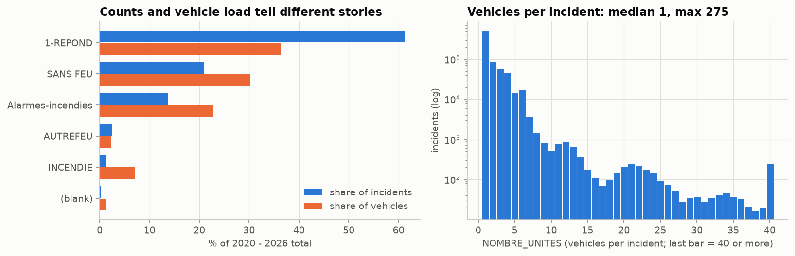

The figure compares each group's share of incidents with its share of vehicles, and the vehicles per
incident. First-responder calls (1-REPOND) are 61% of incidents but only 36% of vehicle deployments. Building
fires are 1% of incidents and 7% of vehicles. Counting incidents is a deliberate choice: it
measures volume, not effort.

### Step 5 · Timing

The last record is 2026-09-24 23:59, retrieved 2026-09-26, a publication lag of **2 days**. That
supports the D−3 cutoff. Timestamps are local civil time. Demand bottoms at 04:00 and stays on a
plateau from 10:00 to 19:00.

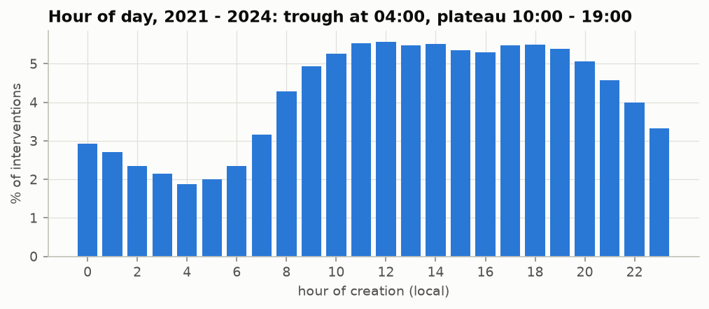

How to read this table: each row is a kind of information, with the moment it becomes known and
whether it may be used to forecast day *D*.

| Variable                                     | Known when                      | Allowed use                |
| -------------------------------------------- | ------------------------------- | -------------------------- |
| Calendar of *D*                              | always                          | predictor                  |
| Daily counts up to *D−3*                     | about 2 days after the day ends | lagged predictor           |
| Type, group, caserne, units of events on *D* | during or after *D*             | never a predictor          |
| Revised type labels                          | unknown delay                   | hindsight labels; not used |

### Step 7 · Missing and non-standard values: planned handling

How to read this table: each row is a data problem, with how many rows it affects, how it shows up,
and what the project does about it. A null is a blank value that is kept as "unknown", not turned
into 0.

| Issue                             |  Rows | Pattern                                       | Planned handling                                                                                                                                                                                                  |
| --------------------------------- | ----: | --------------------------------------------- | ----------------------------------------------------------------------------------------------------------------------------------------------------------------------------------------------------------------- |
| 2024-12-31 absent from both files | 1 day | Systematic: gap between the two exports       | Kept as null, never 0. Lag and rolling features that reach back over it stay null (gradient-boosting models, a type of tree-based machine-learning model, take nulls natively; baselines average the values that exist). Forecasts for that day are not scored. |
| `DIVISION = 0`                    |   600 | Spread over all years, undocumented           | Excluded from the target.                                                                                                                                                                                         |
| Blank `DESCRIPTION_GROUPE`        | 1,788 | Systematic: grows over time, mostly fire-type | Not needed for the target. Counted as non-first-responder in any first-responder share feature.                                                                                                                   |
| `NOUVEAU` group                   |     7 | Rare, undocumented                            | Kept in totals; same rule as blanks.                                                                                                                                                                              |
| Date-only timestamps              |     8 | One per day, no pattern                       | Counted on their date.                                                                                                                                                                                            |
| Blank `NOMBRE_UNITES`             |   156 | Rare                                          | No handling: not used.                                                                                                                                                                                            |

### Step 7 · Coverage, level and composition

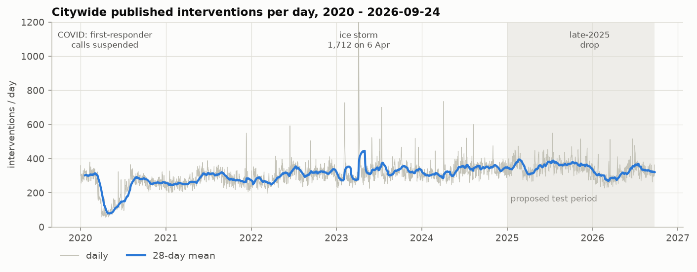

How to read this table: it gives the average number of interventions per day in each year, so you
can see the level rise from 2020 to 2025 and the partial 2026.

| Year                       |  2020 |  2021 |  2022 |  2023 |  2024 |  2025 | 2026 (to Sep 24) |
| -------------------------- | ----: | ----: | ----: | ----: | ----: | ----: | ---------------: |
| Mean interventions per day | 227.2 | 278.2 | 305.6 | 332.9 | 332.7 | 358.3 |            316.2 |

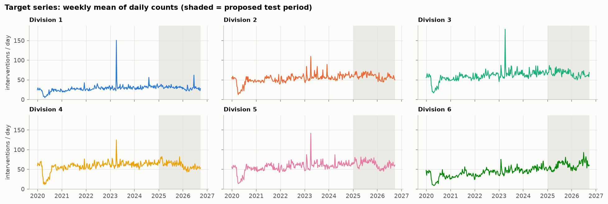

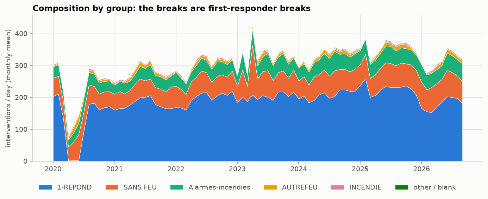

**2026 vs 2025, Jan 1 – Sep 24, % change:**

How to read this table: each column is a division and each cell is the percentage change of 2026
against the same dates in 2025. A negative number means fewer interventions. The bold figure marks
the one division where first-responder calls rose.

| Division                   |     1 |     2 |     3 |     4 |     5 |        6 |
| -------------------------- | ----: | ----: | ----: | ----: | ----: | -------: |
| First-responder (1-REPOND) | −27.8 | −28.5 | −24.9 | −29.8 | −27.0 | **+9.5** |
| All other groups           | +16.0 | +12.4 |  +1.0 |  −1.2 |  +2.8 |     +7.6 |

**Density by grain (why DIVISION × day):**

How to read this table: the grain is what one row of the data stands for (a citywide day, a
division on a day, or a caserne on a day). Cells is how many such rows exist, Median is the middle
daily count, "Zero cells" and "Cells ≤ 5" are the shares of rows with 0, or 5 or fewer, interventions,
and variance/mean compares how much the counts vary with their average (about 1 would be pure
chance; higher is more spread). The bold row is the grain we chose: it has enough events per
cell (median 53) and almost no empty or near-empty cells, unlike the caserne grain.

| Grain              |      Cells | Median | Zero cells | Cells ≤ 5 | Variance/mean |
| ------------------ | ---------: | -----: | ---------: | --------: | ------------: |
| Citywide × day     |      2,458 |    307 |         0% |        0% |          18.7 |
| **Division × day** | **14,748** | **53** |     **0%** | **0.14%** |           7.2 |
| Caserne × day      |    162,228 |      4 |      8.96% |    65.04% |           2.8 |

**Target descriptive statistics (interventions per division-day, 2,458 days each):**

How to read this table: each row is a division. Mean is the average, SD the typical distance from
the mean, and Min and Max the quietest and busiest days. P5 and P95 are the 5th and 95th
percentiles (5% of days are below P5, 95% are below P95), and Q1 and Q3 are the quarter points
(a quarter of days are below Q1, three quarters below Q3), so Q1 to Q3 covers the middle half.
Compare Mean with Median: when they are close the typical day is symmetric. Large Max, Skewness
and Excess kurtosis values (see finding 8 in §1) point to rare extreme days, not to the typical
day.

| Division | Mean |   SD |  Min |   P5 |   Q1 | Median |   Q3 |  P95 |  Max | Skewness | Excess kurtosis |
| -------- | ---: | ---: | ---: | ---: | ---: | -----: | ---: | ---: | ---: | -------: | --------------: |
| 1        | 28.3 | 13.2 |    2 |   15 |   23 |     28 |   33 |   41 |  384 |    11.02 |           245.1 |
| 2        | 54.2 | 14.6 |    6 |   34 |   47 |     54 |   62 |   74 |  221 |     1.71 |            18.0 |
| 3        | 61.2 | 17.6 |    9 |   37 |   53 |     61 |   69 |   84 |  394 |     4.02 |            62.8 |
| 4        | 59.1 | 15.0 |    5 |   37 |   52 |     59 |   67 |   80 |  287 |     1.24 |            23.7 |
| 5        | 57.8 | 16.3 |    5 |   34 |   49 |     57 |   66 |   81 |  353 |     2.87 |            47.8 |
| 6        | 46.0 | 16.1 |    3 |   22 |   35 |     45 |   56 |   73 |  143 |     0.40 |             1.0 |

Moments (the mean, SD, skewness and kurtosis, which use every value) are pulled by extreme values, so a few storm days dominate the SD, skewness and kurtosis; quartiles
are not affected. The typical day is symmetric (mean ≈ median), so MAE, which targets the median,
is the right primary metric.

The figure below shows the same distribution as a letter-value plot, a box plot with extra boxes
for the tails: the wide central boxes are the typical days and the thin outer ones are the rare
extremes.

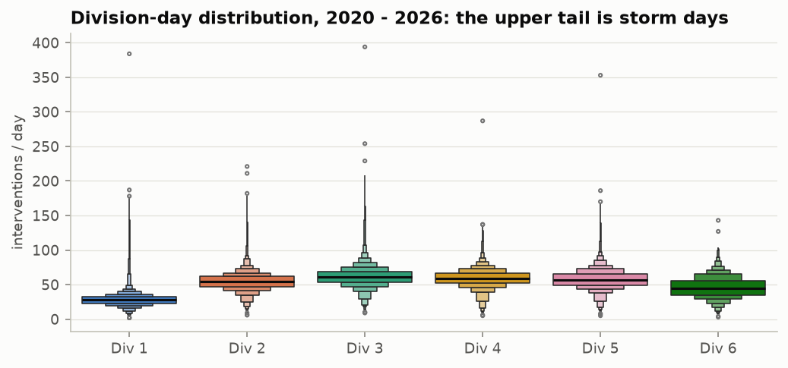

### Step 7 · Seasonality and dynamics (2021–2024)

The heatmap compares each weekday-and-month combination with that division's overall average. An
even picture means the calendar adds little.

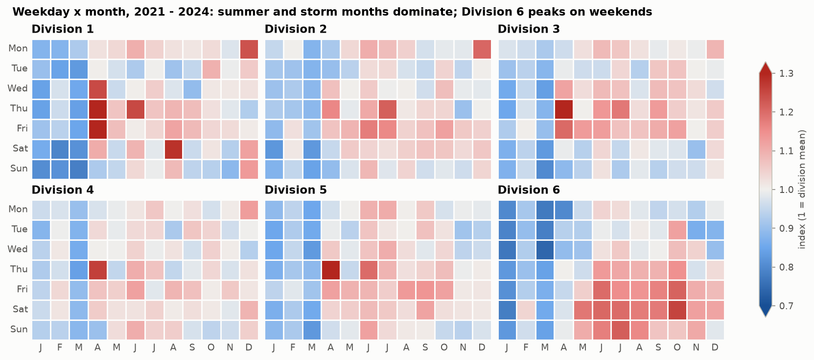

The next figure applies STL (a method that splits a series into a slow trend, a repeating weekly
pattern and leftover noise) to the citywide counts.

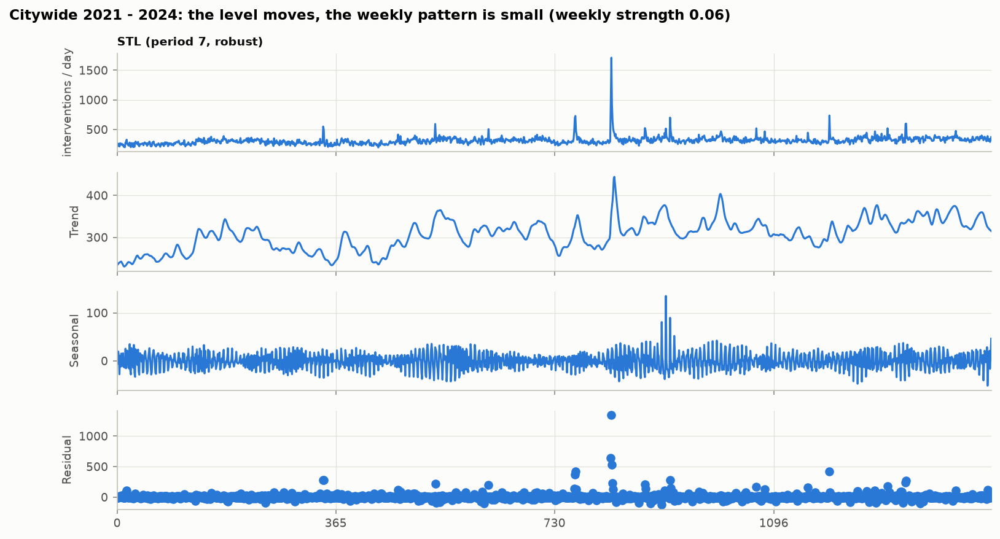

How to read this table: each row is a division. Mean/day is its average count and variance/mean
shows over-dispersion (about 1 would be pure chance, called Poisson). The four ACF columns give the
autocorrelation at lags of 1, 3, 7 and 28 days: how strongly a day's count resembles the count that
many days earlier, from 0 (no resemblance) to 1 (identical). Larger is more predictable from the
past. Lag 3 is the first one allowed by the D−3 cutoff. Division 6 stands out: its resemblance at
lag 7 (0.43) and lag 28 (0.33) is far above the others.

| Division | Mean/day | Variance/mean | ACF lag 1 | ACF lag 3 | ACF lag 7 | ACF lag 28 |
| -------- | -------: | ------------: | --------: | --------: | --------: | ---------: |
| 1        |     29.5 |          7.00 |      0.59 |      0.24 |      0.07 |       0.06 |
| 2        |     55.2 |          3.43 |      0.41 |      0.19 |      0.17 |       0.06 |
| 3        |     62.9 |          4.96 |      0.51 |      0.20 |      0.15 |       0.06 |
| 4        |     61.6 |          2.77 |      0.36 |      0.16 |      0.12 |       0.01 |
| 5        |     58.9 |          4.05 |      0.47 |      0.22 |      0.15 |       0.07 |
| 6        |     43.9 |          3.54 |      0.56 |      0.38 |      0.43 |       0.33 |

The plain meaning of the two stationarity checks: in every division the counts drift around a
slowly moving level rather than wandering off or staying flat. The technical result is that, for
every division, ADF p ≤ 0.0013 and KPSS p ≤ 0.01. ADF (augmented Dickey-Fuller) tests the idea that
the series has a unit root, meaning it wanders like a random walk with no pull back to a level, and
a small p-value (a measure of how surprising the data would be if that idea were true) rejects it.
KPSS tests the opposite idea, that the series stays around one constant level, and a small p-value
rejects that too. Rejecting both fits a level that moves slowly.

The figure below plots the ACF and its partial version, the PACF. The PACF is the ACF with the
effect of the days in between removed, so each lag shows its own direct link.

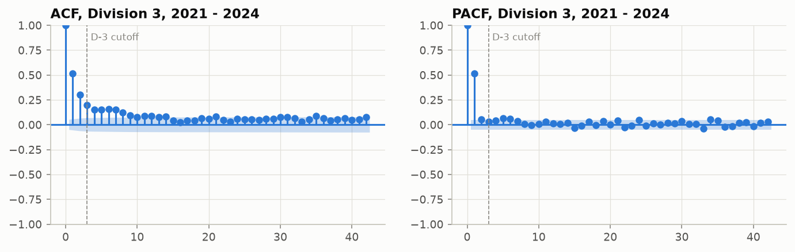

### Step 7 · Anomaly days and shared movement

**Detection.** Ranking days by raw count favours recent years, because the level is higher. Each
division's series is instead decomposed with a robust STL (a LOESS trend of about a month plus a
weekly pattern, with extreme days down-weighted), and the residuals are scaled by their MAD. A
division-day is an anomaly when its robust z-score exceeds 6. That flags about 1% of
division-days by a stated rule. In plain terms:

- LOESS is a smooth curve fitted locally, so it follows a slowly changing trend.
- The residual is what is left of a day's count after the trend and weekly pattern are removed.
- MAD (median absolute deviation) is a typical size of those residuals, measured with the median
  so that extreme days do not distort it.
- The robust z-score is a residual divided by that robust scale. A score above 6 means the day is
  far outside the normal day-to-day variation. The calendar is saved to `data/processed/anomaly_days.parquet`
for evaluation.

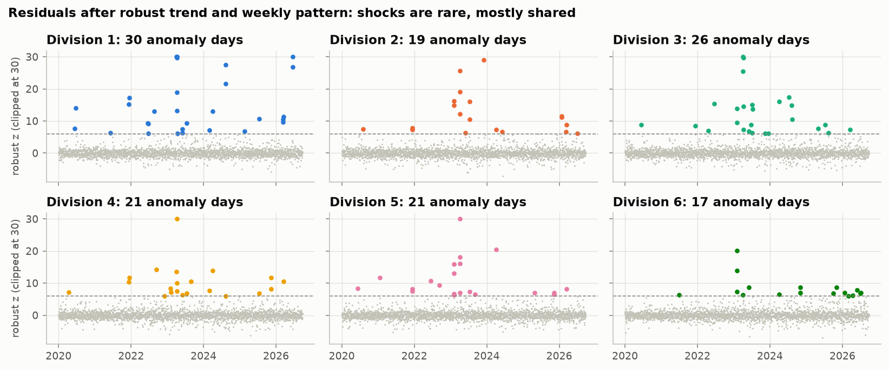

How to read this table: each row is a division. "Anomaly days" counts the flagged days and "Share" is
that count as a percentage of the 2,458 days. "Unusually low" is how many of them were unusually
quiet days, not busy ones, and "Max z" is the largest robust z-score (higher means more extreme).
Most anomalies are busy days.

| Division | Anomaly days | Share | Unusually low | Max z |
| -------- | -----------: | ----: | ------------: | ----: |
| 1        |           30 | 1.22% |             0 |  88.8 |
| 2        |           19 | 0.77% |             3 |  29.1 |
| 3        |           26 | 1.06% |             0 |  53.4 |
| 4        |           21 | 0.85% |             1 |  37.3 |
| 5        |           21 | 0.85% |             0 |  46.9 |
| 6        |           17 | 0.69% |             3 |  20.0 |

**Days anomalous in at least three divisions:**

How to read this table: each row is a date, sorted by the number of divisions flagged on it.
"Citywide interventions" is the total that day, "Non-medical share" is the part that was not
medical calls (21% overall, so higher means an unusual mix), and "Top type" is the most common
incident type that day. `Premier répondant` is first responder, `Problèmes électriques` is
electrical problems and `Inondation` is flooding.

| Date             | Divisions | Citywide interventions | Non-medical share | Top type              |
| ---------------- | --------: | ---------------------: | ----------------: | --------------------- |
| 2023-04-06 (Thu) |         6 |                  1,712 |             72.6% | Problèmes électriques |
| 2024-04-04 (Thu) |         6 |                    736 |             53.8% | Problèmes électriques |
| 2021-12-11 (Sat) |         5 |                    550 |             54.0% | Premier répondant     |
| 2023-02-04 (Sat) |         5 |                    697 |             41.9% | Premier répondant     |
| 2023-02-05 (Sun) |         5 |                    728 |             49.0% | Inondation            |
| 2023-04-05 (Wed) |         5 |                    950 |             64.8% | Problèmes électriques |
| 2023-04-07 (Fri) |         5 |                    930 |             52.5% | Premier répondant     |
| 2023-07-13 (Thu) |         5 |                    701 |             50.9% | Premier répondant     |
| 2026-03-17 (Tue) |         5 |                    513 |             47.3% | Premier répondant     |
| 2021-12-12 (Sun) |         4 |                    499 |             52.7% | Premier répondant     |
| 2023-04-08 (Sat) |         4 |                    639 |             41.0% | Premier répondant     |
| 2023-06-01 (Thu) |         4 |                    524 |             26.2% | Premier répondant     |
| 2020-06-11 (Thu) |         3 |                    324 |             69.8% | Problèmes électriques |
| 2022-06-16 (Thu) |         3 |                    593 |             42.7% | Premier répondant     |
| 2024-08-10 (Sat) |         3 |                    600 |             45.5% | Premier répondant     |
| 2025-07-13 (Sun) |         3 |                    550 |             35.9% | Premier répondant     |

The April 2023 ice storm is confirmed; the other dates match weather patterns (electrical
problems, flooding) but have not been checked against weather records. Detection on residuals
also finds shocks a top-N list misses, such as 2020-06-11: an ordinary-looking 324
interventions, but 70% non-medical during the COVID low.

**Shared vs division-specific movement.** Daily residuals of Divisions 1–5 correlate at
0.39–0.64; Division 6 at 0.14–0.34. A Tukey median polish of the division × month table (log
scale, so effects are percentages) separates the shared month effects from division-specific
residuals. The median polish repeatedly subtracts each division's typical value and each month's
typical value from the table, until what remains is the part specific to one division in one
month. On the log scale, differences become ratios, so an effect reads as a percentage.

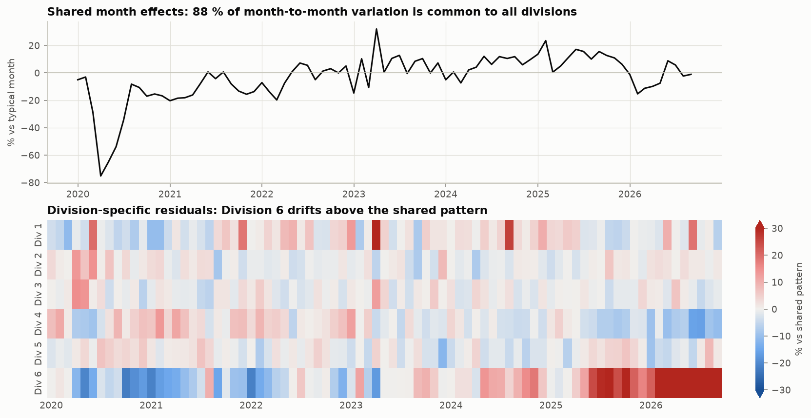

- **88.5%** of month-to-month variation is common to all divisions: COVID (−75% in April 2020),
  the ice storm (+32% in April 2023).
- The late-2025 first-responder drop hit five of six divisions, so it counts as shared movement.
  Division 6, which did not drop, sits **44% above** the shared pattern in 2026, up from about
  10% below it in 2020–21. Divisions 1–5 stay within 10% of it.

### Steps 8–9 · Privacy and what the data do not measure

Locations are snapped to intersections: 99% of rows share a coordinate. About 6% of incident
numbers never appear in the open data. Labels may be revised. There is no personal data.

The data do not include response or arrival times, durations, responding units, crew size,
staffing, unit availability, costs, call priority, outcomes, or unmet demand.

### Step 10 · Fitness: baselines by rolling origin, 2021–2024

MAE in interventions per day, 8,760 division-days per model. Every forecast uses only data at or
before *D−3*; models are refitted monthly. Source:
[`baseline_validation.json`](baseline_validation.json).

How to read this table: each row is a division and each column is one baseline rule, either the
mean of the same weekday over the last 13 weeks or the plain mean of the last 28 days. The cells
are MAE, the average miss in interventions per day, so lower is better. Bold marks the lower MAE in
a row. Divisions 5 and 6 differ by only 0.01 and are left unbolded as ties, but the "All" row bolds
its 0.01 gap, so treat that row as a tie as well (finding 7 in §1). The Bias row is the average of
forecast minus actual: a negative value means too low on average. "Anomaly days out" is the MAE
recomputed with the anomaly days left out.

| Division                | Same weekday, 13 wk | Plain 28-day mean |
| ----------------------- | ------------------: | ----------------: |
| 1                       |            **6.32** |              6.37 |
| 2                       |                8.77 |          **8.74** |
| 3                       |            **9.71** |              9.86 |
| 4                       |                8.84 |          **8.73** |
| 5                       |                9.36 |              9.35 |
| 6                       |                7.88 |              7.89 |
| **All**                 |            **8.48** |              8.49 |
| Bias, all               |               −0.48 |             −0.16 |
| All, anomaly days out   |                7.72 |              7.72 |

Same-weekday windows of 4, 8, 13, 26 and 52 weeks score 9.20, 8.64, 8.48, 8.51 and 8.57 overall,
so 13 weeks is chosen. The original report's 2024-only preview (plain 28-day 8.03, 13 and 26
weeks 8.16) is kept in the [report as presented](https://github.com/abouganemi/ycit440-sim-forecast/blob/v1.6.0/reports/eda_report.md).

---

## 6. Implications for modelling

- **Split.**
  - 2020 serves as lag history only (COVID): its counts feed the model as past inputs and are never
    scored.
  - Fit and select on 2021–2024 with rolling-origin (expanding-window) validation, which replays
    history in time order. Plain k-fold cross-validation (cutting the data into k random parts
    and scoring each from the others) would train on days after the ones it scores, leaking
    future levels and storms into every fold.
  - Test on 2025-01-01 → 2026-09-24. The late-2025 break falls inside the test period, which makes
    it a real drift test.
- **Baseline.** Keep the v2 same-weekday baseline, with the window chosen on validation data:
  13 weeks (MAE 8.48 on 2021–2024). Also report the **plain 28-day mean** as the secondary
  reference recommended in `09_FINAL_VERIFIED.md` §7; over 2021–2024 it ties (8.49), so a model
  has to beat both.
- **Features.**
  - Recent levels (rolling means ending at D−3) and calendar features: weekday, month, holidays.
  - Drop the linear time trend; the red-team review (an independent critical review of the
    project's design) showed it over-predicts after Dec 2025.
  - Add a first-responder share feature to track composition drift (built from past calls up to
    D−3 only).
- **Target scale and loss.** Counts are over-dispersed and right-skewed. Fit on the raw count
  with a Poisson or Tweedie objective (negative-binomial for a GLM), or on `log1p` and transform
  back; compare both on validation MAE, always scored on the original scale. Use quantile
  intervals rather than Poisson ones.
  - In plain terms: the model can learn from the counts as they are, or from a squeezed version
    (`log1p`, the log of 1 plus the count, which shrinks big values). The "objective" is the rule
    the model uses to judge its own mistakes while learning, and the Poisson and Tweedie ones are
    built for counts. A negative-binomial GLM is a classic count regression that allows more
    spread than Poisson. Quantile intervals give a forecast range from the observed spread of past
    errors, not from a Poisson formula.
- **Model structure.** One pooled model across divisions with a division effect: most movement is
  shared. Division 6 needs its own recent-level features, or it will be under-forecast.
  - In plain terms: one model learns from all six divisions together, with an adjustment for
    each division, instead of six separate models. Division 6 needs extra inputs describing its
    own recent level.
- **Evaluation.** Report MAE and bias per division and by month, with and without the anomaly
  days in `data/processed/anomaly_days.parquet`. Anomaly days are not predictable from the
  calendar or from counts up to D−3; use a robust loss or flag them rather than dropping them
  silently from training.
  - In plain terms: report the average miss and bias for each division and each month, with and
    without the storm days. A robust loss is an error rule that does not let a few extreme days
    dominate the fit.
- **Open questions for the team.**
  - What changed in first-responder dispatch in late 2025?
  - What is `DIVISION = 0`?
  - Should public weather forecasts be added? Surges are weather-driven, but the v2 design
    excludes external data.

### How the implications held up

From [`final_report.md`](final_report.md). A 95% CI (confidence interval) is a range of plausible
values for a difference between two models. If it includes 0, we cannot say one model is better
than the other. The noise floor is the error even a perfect model would make, because daily counts
are partly random.

- **The room above the baselines was small, as the weak persistence at D−3 suggested.** The
  noise floor was estimated at about 7.3–7.5 ([`baseline_report.md`](baseline_report.md)). The
  final model, the mean of five forecasters, scored MAE 8.00 on the 2025-01-01 → 2026-09-24 test period against 8.79 for
  the same-weekday baseline (9% lower, 95% CI 0.50 to 1.08, which excludes 0, so this gap is
  significant) and 8.20 for the plain 28-day mean
  (not significantly different overall).
- **The late-2025 break was a real drift test.** Models with recent-level features followed the
  drop; the 13-week same-weekday mean kept forecasting the old level (bias +1.0 after
  2025-12-20) and fell behind.
- **Division 6 was the risk the EDA flagged.** It is the one division the final model
  under-forecasts after the break (bias −0.96), though with a lower point MAE than either baseline (this file gives no interval for that
  comparison).
- **Anomaly days stayed unpredictable**: they carry the largest errors for every model.
- **Raw-count tree models without a level offset could not follow level shifts**: the best single
  model in validation was the worst of the five on the test.

## 7. Differences from the v2 documents

No v2 number is contradicted. These results are new or sharper:

- **The plain 28-day mean is as strong as the chosen same-weekday baseline** (8.49 against 8.48
  over 2021–2024). On 2024 alone it was ahead (8.03 against 8.16), but that does not generalise.
  The red team found that a simple model is only about 1% lower than the plain mean on the
  test period, with a confidence interval including zero, so that is not a significant
  difference. Our final model is 2.5% lower on the test, but that interval also includes zero, so
  it is not a significant win.
- **Division 6 behaves differently.** First-responder calls rose while Divisions 1–5 fell, it has
  the only strong weekend peak, persistent autocorrelation at lag 28, the weakest share of common
  shocks, and it sits 44% above the shared pattern in 2026.
- **Anomaly days come from a stated rule**, robust STL residuals with z > 6, rather than from a
  top-N list of raw counts.
- **COVID gap as defined here:** 56 days with fewer than 5 first-responder records between
  2020-04-07 and 2020-07-07. The red team gives 31 Mar – 8 Jul under a different definition.
- **Share of SIM-reported totals** (93.5–94.3%) is now computed from the files rather than quoted.

## 8. Glossary

Terms are listed in alphabetical order.

- **ACF (autocorrelation function) / autocorrelation / lag:** autocorrelation is how strongly a
  day's count resembles the count a fixed number of days earlier. That number of days is the lag.
  It runs from 0 (no resemblance) to 1 (identical). The ACF is the list of these values for
  several lags.
- **ADF (augmented Dickey-Fuller) test:** a test of whether a series has a unit root. A small
  p-value rejects the unit root.
- **Anomaly day:** a division-day whose robust z-score exceeds 6, such as a storm day.
- **Baseline:** a simple rule that a model must beat. Here, the mean of the same weekday over the
  last 13 weeks (the chosen baseline) and the plain mean of the last 28 days.
- **Bias:** the average of forecast minus actual. Negative means the forecast is too low on
  average, positive too high.
- **Caserne:** a fire station and its territory. It does not nest inside a division.
- **D−3 cutoff:** the forecast for day *D* uses only counts through day *D−3*, because the portal
  publishes about 2 days late.
- **Division-day:** one division on one day, the unit that is counted and forecast.
- **Excess kurtosis:** how heavy the tails of a distribution are compared with a bell curve. 0 is
  bell-shaped, and a large value means rare extreme days.
- **First-responder calls (`1-REPOND`):** the group of interventions where the fire service
  responds as first responder.
- **Gradient boosting:** a type of machine-learning model built from many small decision trees.
- **IQR (interquartile range):** Q3 minus Q1, the width of the middle half of the values.
  Extreme values do not affect it.
- **KPSS test:** a test of whether a series stays around one constant level. A small p-value
  rejects that idea. It is the mirror image of ADF.
- **k-fold cross-validation:** cutting the data into k random parts and scoring each from a model
  trained on the others. It is not used here because it would train on days after the ones it
  scores.
- **Lag history:** earlier counts used as model inputs. 2020 is used only this way and is never
  scored.
- **LOESS:** a smooth curve fitted locally to the data, so it follows a slowly changing trend.
- **`log1p`:** the log of 1 plus the count. It squeezes large values, so a model can learn on a
  smaller scale and the forecast is then transformed back to counts.
- **Log scale (effects are percentages):** on a log scale, differences between values become
  ratios, so an effect of a given size reads as a percentage change.
- **MAD (median absolute deviation):** a typical size of a series' residuals, measured with the
  median so extreme days do not distort it.
- **MAE (mean absolute error):** the average size of the miss, in interventions per day (or per
  division-day). Lower is better.
- **Negative-binomial GLM:** a classic regression for counts that allows more spread than
  Poisson. GLM stands for generalised linear model.
- **Noise floor:** the error even a perfect model would make, because daily counts are partly
  random.
- **Over-dispersion:** counts that vary more than pure chance (Poisson) would give.
- **P5 / P95 and Q1 / Q3:** P5 and P95 are the 5th and 95th percentiles, below which 5% and 95%
  of days fall. Q1 and Q3 are the first and third quartiles, below which a quarter and three
  quarters of days fall.
- **PACF (partial autocorrelation function):** the ACF with the effect of the days in between
  removed, so each lag shows its own direct link.
- **Poisson:** the textbook model for random event counts, where the variance equals the mean.
- **Poisson / Tweedie objective:** the rule a model uses to judge its mistakes while learning,
  designed for counts (Poisson) or for counts with a heavy tail (Tweedie).
- **Quantile intervals:** a forecast range taken from percentiles of past errors, without
  assuming a Poisson formula.
- **Red team:** an independent critical review of the project's design, looking for weaknesses.
- **Residual:** what remains of a day's count after the trend and weekly pattern are removed.
- **Robust z-score:** a residual divided by a robust scale (based on the MAD). Above 6 marks an
  anomaly.
- **Rolling origin:** testing by replaying history one forecast date at a time, giving the model
  only what was known then. It is used instead of k-fold.
- **SD (standard deviation):** a typical distance from the mean. A few extreme days inflate it.
- **Skewness:** how lopsided a distribution is. 0 is symmetric, and a large positive value means a
  long tail of very busy days.
- **STL / seasonal strength:** STL splits a series into a slow trend, a repeating weekly pattern
  and leftover noise. Strength scores how much of the variation the weekly pattern (or the trend)
  explains, from 0 to 1.
- **Tukey median polish:** a method that repeatedly subtracts the typical value of each division
  and each month from a table, leaving the part specific to one division in one month.
- **Unit root:** a series that wanders like a random walk, with no pull back to a level.
- **Variance/mean (variance-to-mean ratio):** how much the counts vary compared with their
  average. About 1 is what pure chance (Poisson) gives, and higher means more spread.

## Reproduce

```bash
uv sync --locked
uv run python -m ycit440_sim_forecast.manifest verify   # same input bytes
uv run --with nbconvert jupyter nbconvert --to notebook --execute notebooks/01_eda.ipynb --output-dir /tmp
uv run python -m ycit440_sim_forecast.evaluate baselines   # the 2021–2024 baseline numbers
```
